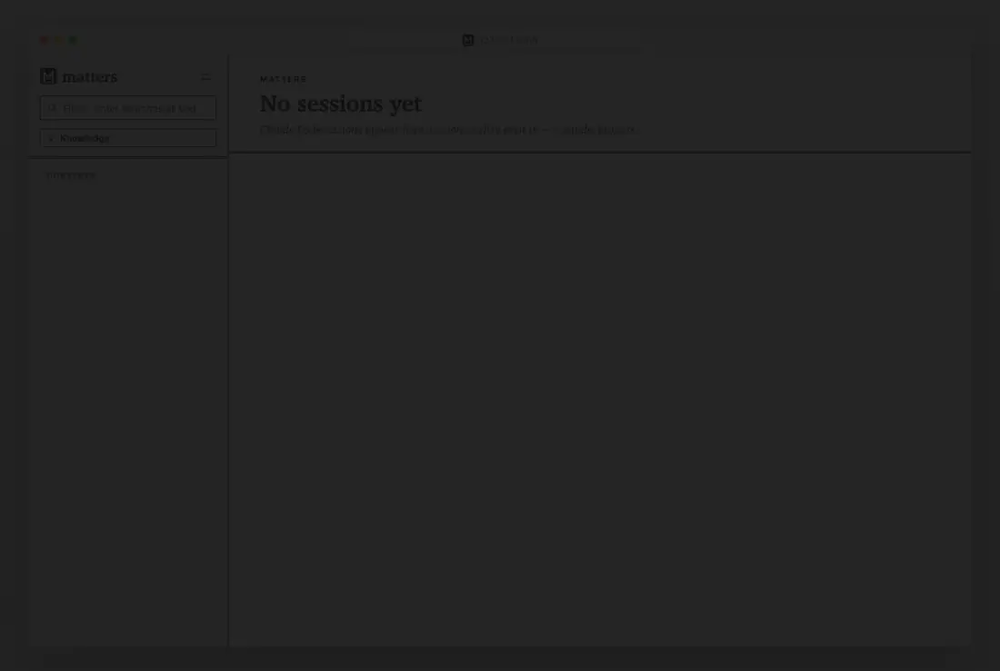

# matters

A reading room for your Claude Code sessions.

Claude Code stores each session as a JSONL file under `~/.claude/projects`.
matters renders them as pages: how each session ended, where the time went,
what changed in each file and why, and where each project stands.

It runs locally and only reads; session files are never changed.

<p align="center">
  <a href="docs/media/demo.mp4"></a>
</p>

## Features

**Session pages.** The header says how the session ended: with an
answer, waiting on your question, interrupted, or with a check still failing.
Then its figures, each in words and each a link to its details: work time,
asks, files changed, checks, knowledge and tokens. Turns read oldest first or
newest first: set the order for every session in the settings menu, or for one
session with the switch above its turns. Long sessions keep three turns open at
the end you read from and fold the rest into chapters of ten. A **Newest turn**
button stays in sight while that turn is out of view.

**Timeline.** One row per kind of work (you, discussion,
exploring, building, verifying, debugging, running) across the session's
active time. Red marks a failed check. Drag across the lanes to zoom into a
stretch, point at a mark to see what happened, click it to open its turn, and
double-click to zoom out. "By token use" shades each mark by the tokens it took:
darker took more, hatched took none.

**File history.** Click a file in the index and its changes open
beside the page, latest on top. Each layer is numbered by the turn that made
it and shows the ask behind it. The file tree stays alongside for moving
between files.

**Search.** Type in the sidebar to filter sessions. Press Enter to
search everything you asked, everything the assistant answered, and every
command and its output. A hit opens its turn with the words marked.

**Project brief.** Click a project's name to see your last ask,
the sessions that ended unfinished and why, the knowledge you've settled on,
and every file touched with the turns that touched it. Every line links to its
source. The same brief prints as Markdown in a terminal.

**Knowledge.** Pick sessions and Claude drafts the
preferences and facts you stated in them ("store everything in UTC", "no
Redis, this runs on a Pi"). Each item quotes you, and you accept or reject it.
Accepted items export to `PREFERENCES.md` and `FACTS.md`, and the turn you said
each one in shows what it became.

## Install

Requires [Claude Code](https://docs.claude.com/en/docs/claude-code) and
[uv](https://docs.astral.sh/uv/).

```sh
uv tool install --python ">=3.12" git+https://github.com/galmeriol/matters.git
```

This installs `matters` on your PATH in its own environment. If the command
isn't found, run `uv tool update-shell`. Update with `uv tool upgrade matters`,
remove with `uv tool uninstall matters`.

## Run

```sh
matters serve     # opens http://127.0.0.1:8765
```

Or keep it running in the background after you close the terminal:

```sh
matters start     # add --open to open a browser tab
matters status    # is it running? where is its log?
matters restart   # after an upgrade, to run the new version
matters stop      # stops it, from any terminal
```

Sessions are read from `~/.claude/projects`. A session that is still being
written says so: a pulsing dot in the sidebar, "Running" with how long ago it
last moved, the subagents still at work, and a Refresh link to load what came
since. Each session has a **Copy resume command** button for picking it
up again in Claude Code.

The sliders button at the top of the sidebar picks a theme (Paper, Warm or
Library), Auto, Light or Dark, and the order of every session's turns. The
choices are kept in your browser.

A project's brief, in a terminal:

```sh
matters brief ~/code/my-project    # Markdown, every line linked to its source
```

### Keys

| Key | Does |
| --- | --- |
| `j` / `k` | Next and previous turn, or diff layer when a file is open |
| `G` | The newest turn |
| `[` / `]` | Previous and next session |
| `/` | Focus the filter; Enter searches all text |
| `n` / `N` | Next and previous search match |
| `e` | Unfold or fold all work |
| `t` | Show or hide where the time went |
| `Esc` | Close the file panel, or zoom the lanes back out |

## Knowledge extraction

Extraction runs the `claude` CLI headless (`claude -p`) with your existing
sign-in. Each run:

- saves no session (`--no-session-persistence`), so it never shows up in
  matters as a session of its own;
- has no tools and skips your hooks and settings (`--restricted`);
- reads your `CLAUDE.md` and `AGENTS.md` files too, so it doesn't propose what
  they already say.

Two optional settings, read from the environment when matters starts:

| Variable | What it does |
| --- | --- |
| `MATTERS_MODEL` | A model or alias Claude Code accepts, such as `sonnet` or `opus`. Default: Claude Code's own default |
| `MATTERS_EFFORT` | `low`, `medium`, `high` (default), `xhigh` or `max` |

```sh
MATTERS_MODEL=sonnet matters start
```

## Privacy

- The viewer listens on localhost only.
- Session files are only read, never changed.
- Nothing is sent anywhere until you extract knowledge. Then only the sessions
  you picked (and your instruction files) go to Claude, through your own Claude
  Code, with secrets redacted first.

## Development

```sh
git clone https://github.com/galmeriol/matters.git matters
cd matters
uv sync                # a .venv with matters and the dev tools
uv run matters serve   # the viewer, from this checkout
make check             # tests, lint, format check and strict types; every change must pass
make help              # all targets
```

Design notes are in [docs/ARCHITECTURE.md](docs/ARCHITECTURE.md).
